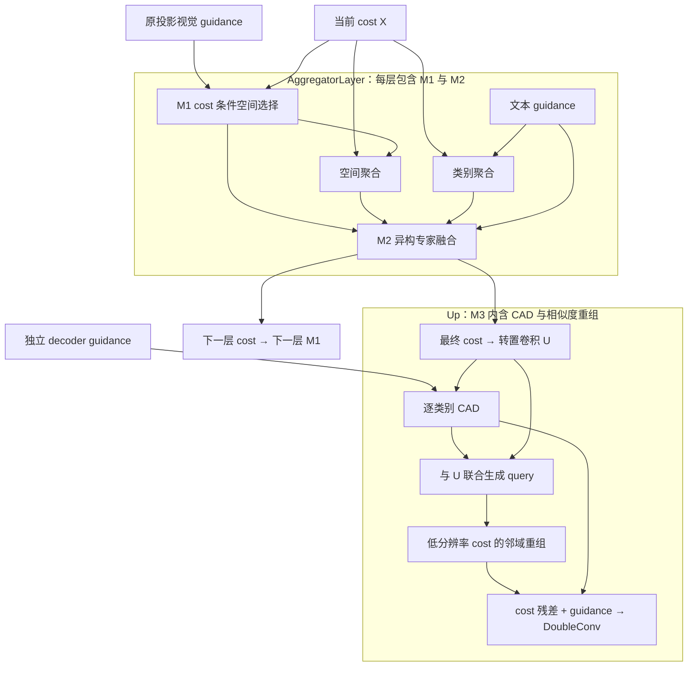

# 三模块加强原型：计算职责与条件化联系

基于 `cb3fc41dd342d5c1afdd2507c818d48901a8a5b2`。本轮研究的重点不是代码
行数，而是现有模块未使用的信息、不同分支的计算职责，以及阶段之间的反馈。
默认 baseline/full/full_selective 保持原计算；新实验叫 `full_interaction`。
没有真实遥感结果，不能将“结构更丰富”写成“性能更强”或原创贡献的证明。

## 实际读了哪些官方实现

固定源码版本见 [INTERACTION_SOURCES.json](INTERACTION_SOURCES.json)。本轮
读取以下核心类与前向，未运行其原论文训练或借用其数据集上的提升数值。

| 方法与发表位置 | 阅读入口 | 对当前设计有用的机制 | 本轮取舍 |
|---|---|---|---|
| LSKNet，ICCV 2023 / IJCV 2024 | `LSKblock`、`Attention`、`Block` | 不只是大核：空间选择包在带归一化、通道变换、layer scale 的残差块内 | 保留串联局部/上下文，新增 cost 条件选择与通道变换 |
| SegNeXt，NeurIPS 2022 | `AttentionModule`、`Block` | 多尺度条带空间计算与独立 MLP 子层 | 新增条带候选及条带专家；没有搬入整套 MSCAN |
| Mask2Former，CVPR 2022 | decoder `forward`、`forward_prediction_heads` | 当前预测决定后续注意力读取范围 | 借鉴“当前状态条件化下一步”；不移植 detach 的硬 mask、固定 query、分类头或辅助损失 |
| Restormer，CVPR 2022 | `FeedForward`、`Attention` | 通道展开、深度卷积与乘性门控分工 | 独立实现门控空间 FFN；没有引入其 MDTA |
| SAPA，NeurIPS 2022 | `SAPA.forward`、`attention` | 高分辨率 query 与低分辨率局部 key 的相似度决定 value 重组 | 在逐类别 cost 上实现局部相似度参考算子；query 同时包含 cost 与 CAD guidance，不声称等价 SAPA |
| FADE，ECCV 2022 / IJCV 2024 | `SemiShift`、`FADE`、`FADELite` | 编码/解码信息共同参与核生成，语义控制细节补充 | 借联合条件化思路；没有移植 SemiShift 或原 gate 公式 |
| FreqFusion，TPAMI | `FreqFusion._forward`、`LocalSimGuidedSampler` | 低通重组、高通细化、位置修正各自处理不同融合问题 | 保留为解码竞争方案；本轮不将全部滤波器再堆入 M3 |
| UniRepLKNet，CVPR 2024 / TPAMI 2025 | `DilatedReparamBlock`、`UniRepLKNetBlock` | 多分支空间训练、通道处理与部署折叠分别组织 | 本轮不接入 BN 折叠；当前采用 GroupNorm，不能声称可等价折叠成卷积 |

这些方法的核心块有的只有几十行。应借鉴有任务依据的计算组织，而不是
根据行数或会议级别判断模块是否有效。异构结构也只提供不同的归纳偏置，
不能保证专家自动学会道路、建筑、水体等语义分工。

## M1：每层重选空间上下文

`CostConditionedGuidance` 包含在每个 `AggregatorLayer` 内，读取当前 cost
`[B,C,K,H,W]` 和原始投影 guidance `[B,D,H,W]`。原 LSK 的视觉范围选择
不看当前匹配状态；现在让当前 cost 决定如何使用视觉上下文。

先将每个真实类别 cost 投影到 D 个通道，与共享视觉 feature 乘性交互，
经 GELU 和共享 scorer 产生类别权重。类别 softmax 做特征摘要，得到
`[B,D,H,W]`；这些权重是特征选择偏好，不是经标定的分割置信度。
摘要与视觉 feature 一起生成三路独立 sigmoid：局部 DW5、串联 DW7 膨胀
上下文、DW(1×7)→DW(7×1) 条带。选择后的结果进行乘性交互、投影和小幅
残差更新，再经过独立门控 FFN 残差。两个残差系数按通道学习，初始 0.01。

空间 banks 在 B 维计算，cost 投影在 B*K 维计算；这不是整个 M1 都与 K
无关。每层各有参数并重算 banks。每次都从原始 projected guidance 出发，
避免在层间连续累加 guidance；当前 cost 则包含上一层融合结果。
K=1 时摘要 scorer 的选择梯度为零，这是类别 softmax 的预期性质。

## M2：有不同空间职责的专家融合

`InteractionFusion` 替换同构 EPL 候选，但不更改空间、类别 attention 的
内部深度。两路仍读取同一 X。拼接 S、C、|S−C|、S⊙C 后，经 GN、1×1、
GELU 生成联合 feature。逐类别文本投影、M1 输出的视觉投影与 feature
共同进入非线性 router，因此文本和视觉可以改变专家权重。

四个专家都采用通道展开、乘性门控、输出投影，空间变换分别为 DW3、
DW5→DW7(dilation=2)、DW(1×7)→DW(7×1)、无空间卷积的通道映射。
全部专家执行，softmax 在每个类别/像素上融合。先保留两路均值 anchor 并
添加专家残差，再用独立门控 FFN 做通道重组。两个通道残差 scale 初始 0.01。

这不是稀疏 MoE，没有负载均衡损失，也不是 PCA-Seg 原版 EPL。
不同专家结构提供局部、较大上下文、条带和通道映射的候选计算；实际利用
情况要看训练后的路由、各专家输出相关性和残差强度。

## M3：CAD 参与 cost 重组

`JointAffinityDecoder` 包在启用 CAD 的 `Up` 中，首级默认使用：

1. 原转置卷积仍产生 U，作为明确的 cost anchor。
2. 内部 `ClassGuidanceRefiner` 由每个 U_k 细化共享 decoder guidance，
   输出 Ghat_k；没有类别专属参数。
3. U_k 与 Ghat_k 拼接后经非线性映射生成高分辨率 query。低分辨率 cost
   生成 key/value。每个高分辨率位置比较所关联低分辨率位置的 3×3 邻域。
4. float32 相似度、有效邻域 mask、softmax 得到重组权重；重组 value
   产生 A，输出 U + scale⊙(A−U)。随后与 Ghat_k 拼接进入原 DoubleConv。

因此 Ghat_k 不只是旁路拼接：它也决定 cost 从哪些邻域读取信息。边界处
排除越界 key 后重新归一化，常量 value 不会被 padding 稀释。算子是纯
PyTorch 参考实现，未优化 CUDA 性能；避免一次创建高分辨率 C×9 values，
但 key 邻域、query 和逐类别 guidance 的激活仍增长。只支持当前 2×阶段。
scale 为学习参数，可能离开 [0,1]，不能将输出永久解释为凸组合。

`CAD_MODE=affinity` 要求启用 CAD、`CAD_SCOPE=per_class`、`CAD_POOLING=mean`。
mean 只是有效配置，此路径不摘要类别。原始 guidance 并非新的 RGB 编码
细节，动态重组也不能凭空恢复已丢失的信息。

## 包含关系与跨模块路径



实际依赖按层向前展开，没有循环求解。M2 的输出条件化下一层 M1；最后
的融合 cost 条件化 M3。M1 的原始 guidance 与 decoder guidance 来自
CLIP 的不同投影路径，不把二者误画成同一份跨尺度特征。
代码物理位置是 `modules/interaction.py`，共享门控 FFN 属于内部子块。

## 实验与可归因性

新增四个配置：`interaction_guidance`、`interaction_fusion`、
`interaction_decoder` 分别相对原 baseline 单独启用新 M1/M2/M3；
`full_interaction` 组合全部三块。原来的 full、full_class_cad 等继续保留。

```bash
python tools/smoke_aggregator.py --classes 17 --interaction --device cuda
python train_ovrs.py --dataset-manifest data/dlrsd/manifest.json \
  --experiment full_interaction --output output/full_interaction
```

先单项与 full 比较，再用同一初始化/训练预算做 full_interaction 的减法
消融：M1 `CONTEXT_ADAPTER lsk`，M2 `AGGREGATION parallel_epl`，M3
`CAD_MODE residual`（仍逐类别 CAD）。这些替换分别保留原机制候选。
新结构同 seed 不保证与旧结构共享参数初始化相同，需统一加载共享初值。

每个新 M1 同时改变了摘要条件、条带和 FFN；M2 同时改变了专家结构与
路由条件；M3 同时增加 joint query 和 value 重组。上述对照只能归因到
模块整体。若出现真实收益，必须再固定容量与初始化，分别关闭 cost 反馈、
替换同构专家、取消 guidance 对 query 的条件化，才能支持更细的机制主张。
其中 shared 与 per_class CAD 应单独比较，不能都归因到 affinity。

保持 CLIP 初始匹配不变、参数跨类别共享、动态 K、类别置换等变，并不
保证 unseen 泛化不下降。新条件化可能加强 seen 类偏好，错误 cost 也
可能引导错误范围/邻域；报告 seen、unseen、hIoU、边界指标及多个种子。
不在没有诊断前预设专家均衡或额外一致性损失。

## 验证记录

- 本地 121 项 pytest 通过，包含新增机制的非零有限梯度、类别置换、图像
  隔离、M2→下一层 M1 的真实数据流、CAD→重组的数值影响，以及 CPU bfloat16。
- 原 baseline/full/full_selective 与原源码的参数初值、参数 keys、前向
  和默认 checkpoint 签名完全相同，最大输出差 0。
- ViT-B 对应尺寸 B=1、K=17、24×24、pad_len=256 前后向通过，输出
  `[1,17,96,96]`。聚合器与 decoder 合计 4,667,440 参数，不含 CLIP。
- 完整 CLIP 输入流水线在合成数据上完成两步 CPU 训练、权重保存，以及
  111×149 矩形样本的独立严格评测。只验证接入与运行，不报告性能收益。
- 本轮没有真实遥感训练、CUDA AMP 或 4090 显存测量，不能据此选择最终模型。

本地受控日志位于 `output/interaction_compatibility.json` 与
`output/interaction_smoke.json`；这些文件不纳入 git。
