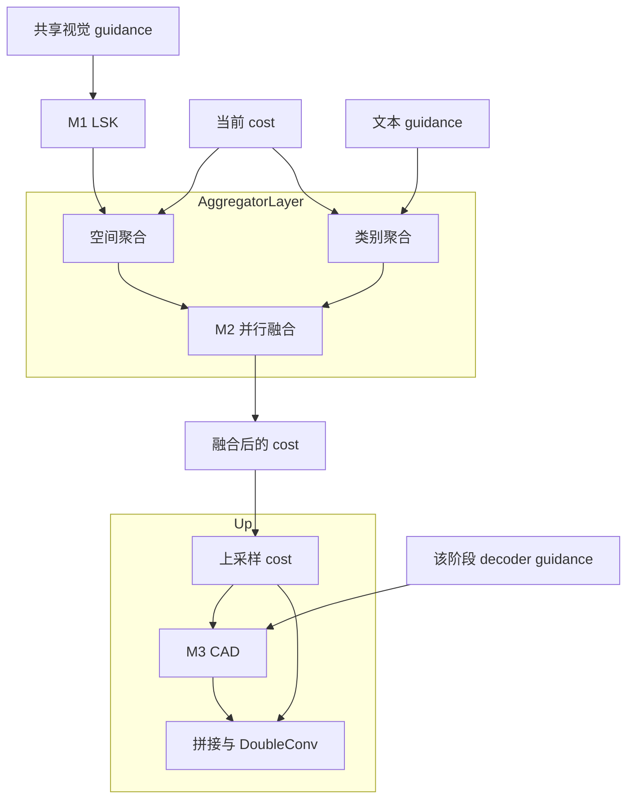

# 三模块原型：组织、契约与交互实验

这轮基于 `eb470ec81ef27ea2df9e2bdc559f69fb3cba39bc` 整理现有原型。
M1 保留当前 LSK；M2 增加等权 EPL；M3 增加逐类别 CAD。默认仍是 learned
路由和 shared guidance，原 full/full_selective 的模型计算不改变。
这里提供可训练的机制对照，最终组合要由真实 seen/unseen 实验决定。

## 模块之间的包含与连接

三个模块分文件实现，但不形成三个互不关联的模型。包含关系是：

- Aggregator 包含共享的 M1 和多个 AggregatorLayer；M1 只计算一次，供各层
  的空间分支使用，不直接重写初始 CLIP 图文 cost。
- 每个 AggregatorLayer 包含空间分支、类别分支和 M2 ParallelFusion。
  两个分支读取同一 cost；EPL 又包含投影、路由器、多个专家和残差映射。
- 每个启用 CAD 的 Up 包含原转置卷积、M3 和 DoubleConv。M3 读取该阶段
  已上采样的 cost，更新该阶段 guidance，随后与逐类别 cost 拼接。
- ClassGuidanceRefiner 复用 CostGuidanceRefiner 的参数构造和 `_refine`
  变换；它改变条件化输入与广播，不复制一套独立的 CAD 算法。



图中展示一层聚合与一级解码；实际融合 cost 可继续进入下一聚合层。
M2 的输出决定 M3 的条件化输入，CAD 的梯度沿 cost 路径回到 M2 和 M1。
decoder guidance 使用独立分辨率的投影，并非把 M1 输出直接上采样后送给
CAD。这里没有新增反馈循环、教师、辅助损失或额外聚合轮次。

## M2：保留专家，只改变路由

`MODEL.OVRS.EPL_ROUTING` 可取 learned/uniform，默认 learned。uniform
固定每个专家权重为 1/E，仍执行全部专家并保留原投影、残差和学习残差系数。
它不是稀疏 MoE，也不是分支等权融合的另一名字。

uniform 构造并保存同样的路由器参数，但将其 requires_grad 置为 False，
前向不调用，现有 optimizer 构造也会跳过这些参数。保留构造顺序使 full 与
原型在同 seed 下拥有相同的参数初值；分配参数量相同，训练参数量不同，
计算也不完全相同。checkpoint 通过非默认路由配置区分两种计算。

该对照检验学习路由是否超出多专家变换的贡献，不能单独证明多个专家优于
容量相近的普通融合块。gated 继续作为两路来源选择的不同候选保留。

## M3：从共享摘要到逐类别条件化

| 接口 | shared | per_class |
|---|---|---|
| 输入 cost | `[B*K,C,H,W]`，图像优先排列 | 相同 |
| 输入 guidance | `[B,D,H,W]` | 相同 |
| 条件化特征 | 类别 mean 或 weighted 摘要 | 每个类别自己的 cost |
| 输出 guidance | `[B,D,H,W]` | `[B*K,D,H,W]` |
| Up 的处理 | 细化后展开 K 次 | 直接拼接，不再展开 |
| CAD 参数 | 对所有类别共享 | 相同，无类别专属参数 |

`MODEL.OVRS.CAD_SCOPE` 默认 shared。per_class 要求 CAD_POOLING 为 mean；
此值用于配置兼容，逐类别前向不执行 mean。weighted 会被拒绝，避免无声
忽略选项。聚合器显式传递真实 K 给 Up，以检查 B×K 顺序与 guidance 布局；
attention 的 padding token 不进入 CAD。

GroupNorm 针对每个图像/类别样本独立计算。固定上游 cost 时，各类别的 CAD
更新互不依赖；上游类别 attention 仍依赖候选集合，所以整模型不具有词表
独立性。K=1 时，使用相同权重的 shared mean 和 per_class 应一致。

shared 失去的是 guidance 更新的类别差异，每个类别自己的 cost 仍参加
最终拼接。cost 无偏置投影后的 GroupNorm 基本抵消整体正比例缩放，不能
把均值数值缩小直接当成语义丢失程度。weighted scorer 表达学习偏好，
不能解读为类别置信度；K=1 时其选择梯度为零是预期行为。

## 2×2 组合与运行

| experiment | EPL 路由 | 首级 CAD |
|---|---|---|
| full | learned | shared mean |
| full_epl_uniform | uniform | shared mean |
| full_class_cad | learned | per_class |
| full_uniform_class_cad | uniform | per_class |

```bash
python train_ovrs.py --dataset-manifest data/dlrsd/manifest.json \
  --experiment full_epl_uniform --output output/full_epl_uniform
python train_ovrs.py --dataset-manifest data/dlrsd/manifest.json \
  --experiment full_class_cad --output output/full_class_cad
python train_ovrs.py --dataset-manifest data/dlrsd/manifest.json \
  --experiment full_uniform_class_cad --output output/full_uniform_class_cad

# M1 仍保留默认 dilation=3，额外范围对照只覆盖一个选项。
python train_ovrs.py --dataset-manifest data/dlrsd/manifest.json \
  --experiment full --output output/full_d2 MODEL.OVRS.LSK_DILATION 2
```

manifest、训练初始化权重与数据划分由自己的协议提供；可用 --weights 统一
加载共享初始化。四个配置固定其他设置，比较相同词表、训练预算与多个 seed。
允许组合存在交互，不要求两个单项都先涨点；单项和组合都要报告，避免把
组合收益归给一个组件。baseline 对 full 仍需通过同一共享 checkpoint 控制
初始化，仅同 seed 不足以保证不同结构的共享权重相同。

旧机制 checkpoint 可以作为新训练的初始化。正式评测和恢复必须匹配机制；
uniform 的 optimizer 参数组与 learned 不同，不能直接复用后者的优化器状态。
新增非默认 EPL_ROUTING/CAD_SCOPE 进入配置签名；默认签名保持原值。

## 检查与成本口径

```bash
python -m pytest -q
python tools/check_prototype_compatibility.py
python tools/smoke_aggregator.py --classes 17 --full --epl-routing uniform
python tools/smoke_aggregator.py --classes 17 --full --cad-scope per_class
python tools/smoke_aggregator.py --classes 17 --full --epl-routing uniform --cad-scope per_class
python tools/probe_module_cost.py
```

兼容检查从指定 git commit 读取原源码；浅克隆缺少该对象时下载固定版本。
默认写入 output/prototype_validation.json，比较 baseline/full/full_selective
的初始化、前向与 checkpoint 签名。成本工具写入 output/prototype_costs.json，
只统计执行的 Conv2d MAC。smoke 支持 --device cuda 和 --output 保存实测结果，
其聚合器/解码器结果不包含 CLIP 或完整训练显存。CPU bfloat16 测试不能代表
CUDA AMP，实际验证范围见 [VALIDATION.md](VALIDATION.md)。

首级 CAD 的 shared/per_class 都有 4,513 参数，逐类别版的细化计算与激活随
K 增长。这个局部倍数不能用于推导整个模型的显存或速度倍数。
当前不为节省成本简化专家或替换上采样，也不预先添加专家均衡损失。

默认探针的两层融合 Conv2d MAC 为 simple 0.642 G、EPL learned 6.761 G、
EPL uniform 6.598 G、gated 0.906 G。shared/per_class 首级 CAD 分别为
0.0101 G/0.1717 G。这些数字帮助核对执行路径，不能替代 CUDA 实测。
